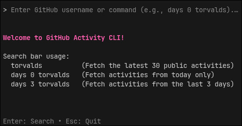
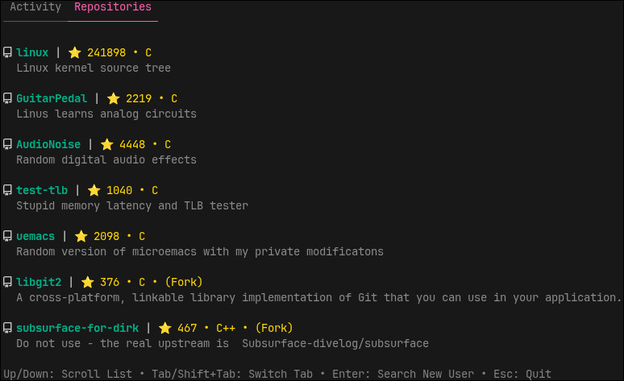

# GitHub Activity CLI

A beautifully designed, interactive Terminal User Interface (TUI) application to explore public GitHub user activities and repositories directly from your terminal.



## Features

- **Global In-App Search**: Type any GitHub username in the global search bar and press Enter to instantly fetch their data without ever leaving the application.
- **Concurrent Fetching**: Seamlessly fetches user activities and public repositories in parallel for a snappy user experience.
- **Time Filtering**: Filter activities by time directly from the search bar using simple commands (e.g., `days 0 username` to fetch today's activity, or `days 3 username` for the last 3 days).
- **Interactive Tabs**: Effortlessly switch between "Activity" and "Repositories" tabs to explore different aspects of a user's GitHub presence.
- **Beautiful UI**: Built with [Bubble Tea](https://github.com/charmbracelet/bubbletea) and [Lip Gloss](https://github.com/charmbracelet/lipgloss) for a rich, dynamic, and colorful terminal experience.
- **Scrollable Viewports**: Never lose track of long data lists. Navigate through extensive event histories and repositories using your keyboard or mouse wheel.

## Screenshots

### Activity Tab
Track pushes, pull requests, issue comments, and other public interactions in real-time.


### Repositories Tab
Explore a user's public repositories, complete with descriptions, languages, and stargazer counts.



## Installation

Ensure you have Go installed (version 1.20 or later), then clone and build the project:

```bash
# Clone the repository
git clone https://github.com/yourusername/github-activity.git
cd github-activity

# Build the executable
go build -o github-activity ./cmd/github-activity
```

## Usage

Simply run the executable:

```bash
./github-activity
```

You will be greeted with the Idle Screen. From there, you can type commands directly into the search bar:
- `torvalds` — Fetches the latest 30 public activities and repositories for user 'torvalds'.
- `days 0 mathfha` — Fetches only today's activity for user 'mathfha'.
- `days 3 mathfha` — Fetches the last 3 days of activity for user 'mathfha'.

### Keyboard Controls
- **Enter**: Execute a search.
- **Tab / Shift+Tab**: Switch between Activity and Repositories tabs.
- **Up / Down**: Scroll through the active list.
- **Esc / Ctrl+C**: Quit the application safely.

## Architecture

This project strictly adheres to Clean Architecture principles and the Elm Architecture pattern (via Bubble Tea):
- **Model**: Manages the application state (input queries, API responses, loading status).
- **Update**: Handles asynchronous events (HTTP responses, keystrokes) to mutate the state.
- **View**: Renders the terminal UI efficiently using styled text and dynamic viewports.
- **API Client**: A robust, context-aware HTTP client handling timeouts, rate limits, and JSON serialization.

## License

MIT License