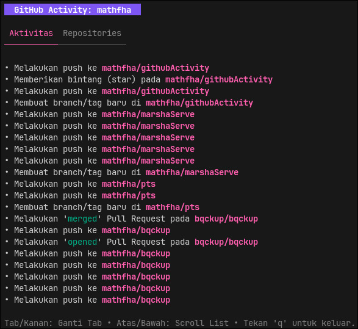
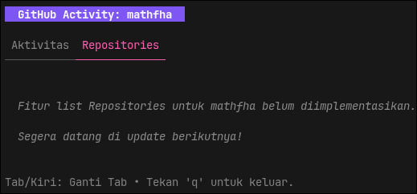
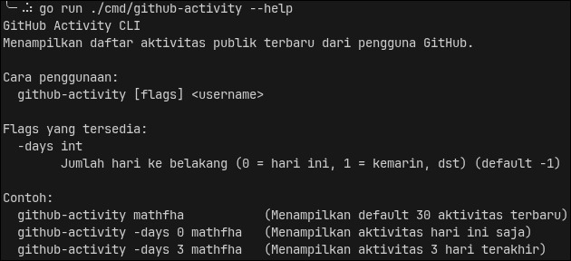

# GitHub User Activity CLI

Aplikasi **GitHub User Activity CLI** adalah program berbasis antarmuka terminal interaktif (TUI) yang dibuat menggunakan bahasa **Go** dan ekosistem **Charmbracelet** (`bubbletea`, `lipgloss`). Program ini mengambil aktivitas terbaru dari seorang pengguna GitHub melalui **GitHub REST API**, kemudian menampilkannya dalam format UI terminal yang cantik, berwarna, dan interaktif.

Project ini dibuat sebagai sarana belajar mengenai:

- Pemrograman Go dasar
- HTTP Client (`net/http`) & Parsing JSON (`encoding/json`)
- Pembuatan Terminal User Interface (TUI) menggunakan arsitektur Elm (*Model-Update-View*)
- Layouting dan *styling* terminal dengan `lipgloss`
- Penggunaan komponen interaktif seperti `spinner`, `viewport`, dan navigasi Tab.
- Konsumsi REST API

---

## Cuplikan Tampilan (Screenshots)

### 1. Tampilan Daftar Aktivitas (Scrollable)


### 2. Navigasi Tab Repositories


### 3. Menu Bantuan (Help)


---

## Fitur Utama

- **Tampilan Interaktif**: Dibangun menggunakan Bubble Tea, menghadirkan interaksi UI langsung di dalam terminal.
- **Navigasi Tabs**: Dukungan perpindahan tab menggunakan tombol panah (`Kiri/Kanan`) atau `Tab` (misalnya untuk fitur *Aktivitas* dan *Repositories*).
- **Animasi Loading**: Menampilkan *spinner* yang halus ketika aplikasi melakukan request data secara asinkron ke GitHub API.
- **Scrollable Viewport**: Jika aktivitas yang ditampilkan lebih dari ukuran layar, Anda bisa melakukan *scroll* ke atas/bawah dengan mudah.
- **Filter Berdasarkan Waktu**: Menampilkan aktivitas untuk hari ini, kemarin, atau beberapa hari ke belakang (menggunakan flag `-days`).
- **Styling Warna Dinamis**: Penyorotan (*highlight*) repositori dan angka commit menggunakan palet warna cantik dari `lipgloss`.

---

## Teknologi yang Digunakan

- **Bahasa**: Go 1.26
- **API**: GitHub REST API
- **Library TUI**:
  - `github.com/charmbracelet/bubbletea` (Framework utama)
  - `github.com/charmbracelet/bubbles` (Komponen Spinner & Viewport)
  - `github.com/charmbracelet/lipgloss` (Engine layout dan pewarnaan)

---

## Struktur Project

```text
github-user-activity/
│
├── cmd/
│   └── github-activity/
│       └── main.go          # Entry point & inisialisasi Bubble Tea Program
│
├── internal/
│   ├── github/
│   │   ├── client.go        # Komunikasi jaringan (HTTP Client)
│   │   └── models.go        # Definisi struktur data (JSON Struct)
│   │
│   ├── ui/
│   │   └── tui.go           # Logika interaktif TUI (Model, Update, View)
│   │
│   └── formatter/
│       └── formatter.go     # Pencetakan format event berpadu lipgloss
│
├── .assets/                 # Aset tangkapan layar untuk dokumentasi
├── go.mod
├── go.sum
└── README.md
```

---

## Cara Kerja Aplikasi

1. Pengguna menjalankan program melalui terminal dengan memberikan parameter `username`.
2. Program merender UI `bubbletea` dalam mode layar penuh (AltScreen) lalu menampilkan animasi *loading*.
3. Sebuah *command* `tea.Cmd` di belakang layar mengirim HTTP GET ke GitHub API.
4. Setelah JSON di-parse dan difilter, program mengirim sebuah pesan (*Message*) ke TUI.
5. Antarmuka berhenti menampilkan loading dan mengubah tampilan (View) untuk merender tabel/list aktivitas ke dalam *Viewport* yang bisa di-scroll.
6. Pengguna bisa keluar dari aplikasi dengan aman menekan `q`, `Esc`, atau `Ctrl+C`.

---

## Cara Menjalankan

Clone repository:

```bash
git clone https://github.com/username/github-user-activity.git
cd github-user-activity
```

Jalankan program (otomatis mengunduh dependensi module Go):

```bash
go run ./cmd/github-activity mathfha
```

Jalankan dengan memfilter jumlah hari ke belakang:

```bash
go run ./cmd/github-activity -days 0 mathfha   # Hanya aktivitas hari ini
go run ./cmd/github-activity -days 3 mathfha   # Aktivitas dalam 3 hari terakhir
```

Tampilkan bantuan (Help):

```bash
go run ./cmd/github-activity --help
```

Atau *build* sebagai binary independen:

```bash
go build -o github-activity ./cmd/github-activity
./github-activity -days 1 mathfha
```

---

## Event GitHub yang Dikenali

| Event | Output UI |
|---------|----------|
| PushEvent | Melakukan push X commit ke repo |
| CreateEvent | Membuat branch atau tag |
| DeleteEvent | Menghapus branch atau tag |
| PullRequestEvent | Melakukan pull request |
| IssuesEvent | Melakukan issue |
| IssueCommentEvent | Memberikan komentar pada Issue |
| WatchEvent | Memberikan bintang (star) |
| ForkEvent | Melakukan fork repo |
| ReleaseEvent | Mempublikasikan release baru |

Event lain yang belum didukung akan tetap ditangani dan ditampilkan secara aman sebagai format aksi umum.

---

## Lisensi

Project ini dibuat sebagai media pembelajaran dan dapat digunakan, dimodifikasi, maupun dikembangkan sesuai kebutuhan.